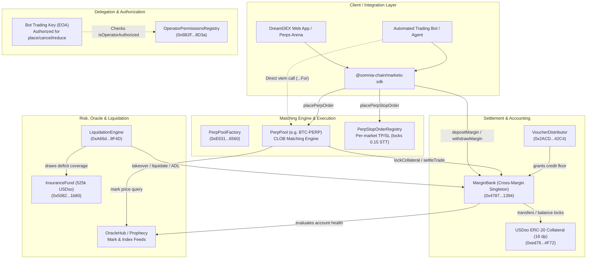
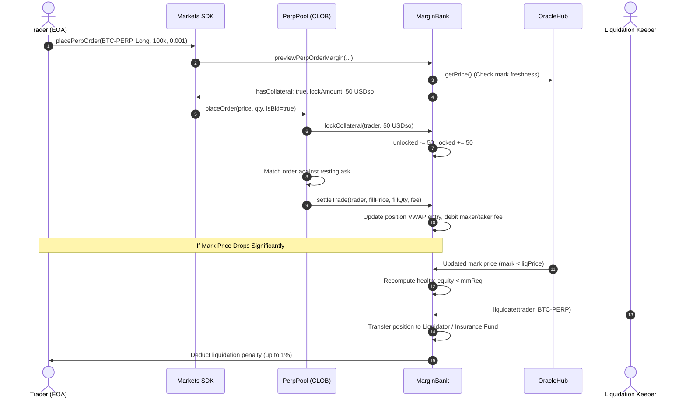

# dreamDEX Perps Protocol Architecture

## 1. High-Level Component Topology

---

## 2. Core Components & Responsibilities

### A. MarginBank (`0x478769E1177C0773c43A593DCCc4Ad15F15F1394`)
- **Central Custody & Ledger**: Holds 100% of collateral (`USDso`) deposited for perpetual futures.
- **Cross-Margin Engine**: Aggregates positions across all 21 active `PerpPool`s into a single account equity view.
- **Collateral States**:
  - `unlockedCollateralBalance`: Free USDso available to back new orders or be withdrawn.
  - `lockedCollateral`: Collateral committed to open resting orders and initial margin for active positions.
  - `equity = unlocked + locked + sum(unrealizedPnl) - sum(accruedFunding)`.
  - `withdrawable`: Collateral exceeding total initial margin requirement (`imReq`) and pending obligations.
- **Auto-Pull Top-Up**: When an order owner calls `placeOrder` directly, if the bank balance is insufficient, the pool invokes `MarginBank.quoteOrderTopUp` -> `depositFor` to pull USDso directly from the user's EOA wallet (requires ERC-20 approval).

### B. PerpPool (`0x...` per market)
- **Central Limit Order Book (CLOB)**: Fully on-chain order matching engine handling bids and asks.
- **Matching & Order Types**: Limit, Market (IOC / FOK), Post-Only.
- **Order Lifecycle**: Placement (`placeOrder`, `placeOrderFor`), Cancellation (`cancelOrder`, `cancelOrderFor`), Reduction (`reduceOrder`, `reduceOrderFor`), Amend (`amendOrders`).
- **Settlement Callback**: On order fill, notifies `MarginBank.settleTrade` with realized PnL, VWAP entry adjustments, and maker/taker fee debits.
- **Grid Constraints**: Strictly enforces `tickSize` (multiples of price), `lotSize` (multiples of base quantity), and `minQuantity`.

### C. OperatorPermissionsRegistry (`0x6B2FbfeD328FF5F20C0BE7D3C3437613aFFE8D3a`)
- **Non-Custodial Bot Delegation**: Traders grant a dedicated bot key (EOA) permission to trade on their behalf without giving custody of funds.
- **Authorized Selectors**:
  - `placeOrderFor`: `0x80054449`
  - `cancelOrderFor`: `0xe37b444b`
  - `reduceOrderFor`: `0x364c2587`
- **Invariants**:
  - A linked bot key CANNOT call `withdrawMargin`, `transfer`, `setPerpLeverage`, or arm stop orders.
  - All margin locks and order fills affect the owner's account exclusively.
  - Fills and refunds return to the owner's `MarginBank` account, never the bot key.

### D. LiquidationEngine (`0xA66d3C24Ad4a389d863846905D8173e1017e9F4D`)
- **Trigger Condition**: Account health drops below maintenance margin requirement (`equity < mmReq`).
- **Liquidation Waterfall**:
  1. **Backstop Bidders**: Take over bankrupt positions at a discount (`penaltyBps = 100n`, 1%).
  2. **Insurance Fund**: Absorbs residual deficit / bad debt (`totalBalance: 525,000 USDso`).
  3. **Auto-Deleveraging (ADL)**: If the insurance fund cannot cover bad debt, profitable counterparty positions are forcibly unwound in ranking order.

### E. PerpStopOrderRegistry (Per-Market Contract)
- **Take-Profit / Stop-Loss Execution**: Independent registry per market managing conditional orders.
- **Gas Prepayment**: Locks `0.15 STT` per armed stop to pay keeper trigger gas. Refunded upon cancellation.
- **Bracket Binding**: Links TP and SL legs so triggering one leg atomically cancels the opposing leg and refunds its STT.

### F. VoucherDistributor (`0x2ACD9EFdA721450906bfE1bef3edE269636E42C4`)
- **Perps Arena Credit**: Grants 1,000 paper USDso credit floor to eligible testnet participants.
- **Confinement Rules**:
  - Only allowed to open positions in allowlisted markets (14 of 21 markets; e.g., excluded from 1000PEPE, LIT, PUMP, VVV, ZEC, ZRO).
  - Position increases in non-allowlisted markets revert (`voucherBlocked`).
  - Credit cannot be withdrawn or transferred out of the MarginBank.

---

## 3. Trust Boundaries & Actor Capabilities

| Actor / Role | Permitted Actions | Prohibited Actions | Critical Invariants |
| :--- | :--- | :--- | :--- |
| **Account Owner (EOA)** | Full control: deposit, withdraw, place, cancel, set leverage, arm stops, link bots | Cannot bypass margin checks or withdraw locked margin | Withdrawals bounded by `withdrawable` equity |
| **Linked Bot Key (Operator)** | `placeOrderFor`, `cancelOrderFor`, `reduceOrderFor` on authorized pools | Cannot withdraw, cannot transfer, cannot set leverage, cannot arm stops | `isOperatorAuthorized(owner, operator, selector) == true` |
| **PerpPool** | Call `MarginBank.lockCollateral`, `MarginBank.settleTrade` | Cannot arbitrarily debit un-collateralized user funds | Only callable during valid order matching / settlement |
| **Liquidation Keeper** | Call `liquidate` / `takeover` on insolvent accounts | Cannot liquidate healthy accounts (`equity >= mmReq`) | Strict health check using live mark price |
| **PerpStopOrderRegistry** | Place orders into PerpPool on behalf of user upon price trigger | Cannot execute when trigger conditions are unmet | Requires `OperatorPermissionsRegistry` grant from user |
| **Protocol Admin** | Pause pools, update fee caps, register new pools | Cannot seize healthy user collateral in MarginBank | Multi-sig / governance governance delays |

---

## 4. Financial & Position Lifecycle Flow

### Placement -> Settlement -> Liquidation Sequence

